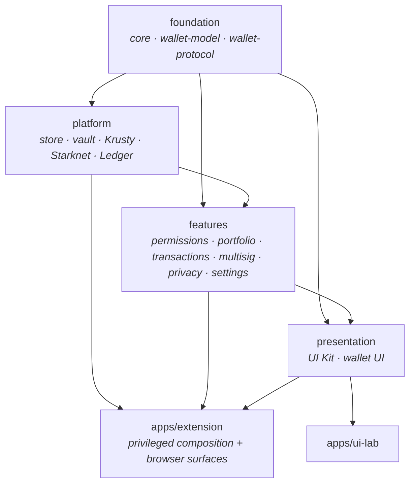
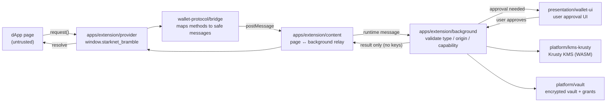

# MC Wallet — Start Here for Engineers

A reading order and two orientation diagrams for people working on the codebase.
It threads the existing docs together and makes the enforced import-layering and
the untrusted-message path legible as pictures, rather than only as scripts. It
does not replace those docs — it points at them.

---

## Reading order

Read these in order before your first change:

1. **[README.md](https://github.com/starknet-innovation/mc-wallet/blob/main/README.md)** — what the wallet is, the feature set, quick
   start, and the offline-runnable check subset.
2. **[AGENTS.md](https://github.com/starknet-innovation/mc-wallet/blob/main/AGENTS.md)** — the operational engineering guide: setup
   commands, the workspace layout, the hard rules enforced by `bun run check`, and
   the "reuse before writing" anti-drift notes.
3. **[CONTRIBUTING.md](https://github.com/starknet-innovation/mc-wallet/blob/main/CONTRIBUTING.md)** — the binding architecture and
   security rules, the branch/release/PR workflow, and the taste bar.
4. **[docs/ARCHITECTURE.md](../architecture/)** — the deep tour: trust
   boundaries, the pinned account/multisig class hashes, the dApp provider
   surface, storage migrations, and the design system.
5. **[docs/MODULAR_ARCHITECTURE.md](../modular-architecture/)** — the implemented
   package graph, internal capability layout, typed invariants, and enforcement gates.
6. **[DEVELOPMENT.md](https://github.com/starknet-innovation/mc-wallet/blob/main/DEVELOPMENT.md)** — day-to-day developer workflow.
7. **[docs/security-audit/](../security-audit/)** — threat model, methodology,
   findings, and the directory-by-directory reviews.
8. **[RELEASING.md](https://github.com/starknet-innovation/mc-wallet/blob/main/RELEASING.md)** — how a release is cut and promoted.

For the *why* behind any rule, `CONTRIBUTING.md` and `AGENTS.md` are canonical;
this page only helps you find them.

---

## Module map (workspace layering)

The repository is one deployable extension organized as private Bun workspaces. The deny-by-default
adjacency matrix in
[`scripts/check-workspace-architecture.ts`](https://github.com/starknet-innovation/mc-wallet/blob/main/scripts/check-workspace-architecture.ts)
checks declared `workspace:*` edges, explicit exports, cross-workspace imports, and cycles. Arrows
below mean “is a dependency of”; dependencies flow upward toward application composition roots.

Important negative edges are structural: foundation cannot import platform, features, presentation,
or apps; features cannot import Chrome or presentation; wallet UI cannot import vault, Krusty,
browser storage, or concrete hardware transports; and page-side provider code cannot acquire a
privileged package. `bun run check:imports` evaluates the exact graph.

---

## Data flow: the untrusted message path

A dApp on a web page is **untrusted**. Its request crosses several boundaries
before any key material is touched, and signing/vault operations are never
exposed to the page. The privileged `background` layer validates type, origin,
and capability on every extension message.

Key invariants (see `docs/ARCHITECTURE.md` §dApp Provider and `AGENTS.md`):

- The page never talks to the background directly; it sees only
  `window.starknet_bramble`. Provider and content entrypoints remain on the untrusted side.
- The dapp-reachable method set is the enforced-derived `DAPP_MESSAGES` allowlist
  in `apps/extension/src/background/routing/senders.ts`; a new dapp-facing method must be added there
  deliberately.
- Krusty KMS owns all wallet crypto. If it is unavailable, the wallet fails
  closed — there is no local signing fallback.
- Secret-material field names may appear only in the boundary modules whitelisted
  in `scripts/check-file-standards.ts`.
