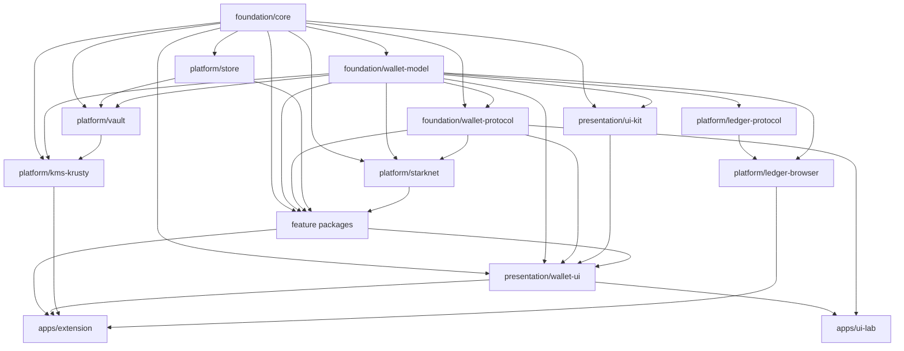

# Bramble modular architecture

This document defines the source and package architecture implemented for Bramble and records the
migration that delivered it. Bramble remains one statically packaged Chrome MV3 extension with one
privileged background authority. The packages are private compile-time boundaries, not separately
deployed services or runtime plugins.

The design has two goals:

1. Make the extension directory and each runtime trust boundary immediately legible.
2. Make every subsystem independently understandable, testable, and composable through narrow
   typed contracts without weakening runtime validation.

## Status and baseline

The migration branch starts from post-v0.9 `main` commit
`bd9fcbb34ed2fbf9fc8ac48186ac88785bca37b6`.

The migration is implemented on `chore/modular-wallet-architecture`: the legacy root `src/` tree
has been removed, every extension surface is owned by `apps/extension`, reusable production code
is split across the packages below, UI Lab uses declared package exports, and
`check-workspace-architecture.ts` enforces the private graph offline. The figures that follow are
the measured pre-migration baseline retained for comparison.

The baseline graph contains approximately 400 source modules. Although no file-level import cycle
exists, these nine top-level directories form one strongly connected architectural component:

`crypto`, `ledger-grant`, `popup`, `provider`, `sidepanel`, `starknet`, `storage`, `ui`, and
`wallet`.

Entrypoint dependency closures at the baseline are:

| Entrypoint | Transitive source modules |
| --- | ---: |
| Background service worker | 197 |
| Side panel | 256 |
| Ledger grant tab | 60 |
| Content script | 24 |
| Injected provider | 24 |
| Sandbox renderer | 2 |

The pre-migration directory names communicated intent, but the root package, root TypeScript program, and
allow-by-default import rules still treat the extension as one codebase. Examples of ownership
running backwards include storage importing a side-panel icon type, Ledger grant importing
side-panel transport implementations, Starknet adapters importing stored record types, and the
page-provider closure importing vault-schema code.

The background producer and popup/side-panel consumer also independently declare at least 29
same-named response models. UI Lab imports production implementation files through
`../../../src/...`, and Terminal separately defines parts of the public Wallet API and STRK20
schemas. Those copies validate untrusted values, which is required, but their definitions can
drift.

## Architectural decision

Bramble is a **modular monolith with hexagonal boundaries**:

- Runtime isolation continues to come from Chrome execution contexts, CSP, extension permissions,
  sender validation, and the background-only custody boundary.
- Private workspace packages provide compile-time ownership and dependency direction.
- Pure packages define domain values and application decisions.
- Ports describe the browser, storage, KMS, hardware, network, clock, and entropy capabilities an
  operation needs.
- Concrete adapters live at the edge and are wired explicitly by application composition roots.
- Every value crossing a runtime or persistence boundary remains `unknown` until a runtime parser
  returns a trusted domain value. TypeScript types never replace validation.

There is no runtime plugin loader, service locator, dependency-injection container, event bus,
independent internal package versioning, or framework rewrite.

## Repository layout

```text
apps/
  extension/
    public/
    src/
      background/
        accounts/
        approvals/
        ledger/
        multisig/
        onboarding/
        portfolio/
        privacy/
        provider/
        routing/
        runtime/
        settings/
        transactions/
      content/
      provider/
      sidepanel/
      ledger-grant/
      sandbox/
      browser-storage.ts
    build.ts
    package.json

  ui-lab/
  terminal/

packages/
  foundation/
    core/
    wallet-model/
    wallet-protocol/

  platform/
    store/
    vault/
    kms-krusty/
    starknet/
    ledger-protocol/
    ledger-browser/

  features/
    permissions/
    portfolio/
    transactions/
    multisig/
    privacy/
    settings/

  presentation/
    ui-kit/
    wallet-ui/

  testing/
    testkit/

contracts/
vendor/
scripts/
tests/
  conformance/
  integration/
  e2e/
```

This is an ownership map, not a requirement to create empty packages. A package is introduced only
when production code and a meaningful boundary move into it.

### Internal capability layout

Package boundaries own trust and dependency direction; capability folders make each package
legible without inventing more packages. The enforced examples are:

```text
apps/extension/src/background/
  index.ts                 # privileged composition only
  routing/                 # message parsing, sender gates, dispatch context
  runtime/                 # session, RPC capabilities, active state, events
  accounts/ approvals/ ledger/ multisig/ onboarding/
  portfolio/ privacy/ provider/ settings/ transactions/

packages/presentation/wallet-ui/src/sidepanel/
  index.ts                 # production entry export only
  app/
    start.ts               # UI composition
    navigation/ rendering/ screens/ sync/
  journeys/                # onboarding, send, swap, privacy, multisig, etc.
  runtime/ shared/ shell/ styles/

apps/terminal/src/
  data/ protocols/ screens/ wallet/   # each subdivided by owned protocol or user task

apps/ui-lab/src/
  fixtures/ runtime/ scenarios/ stories/
```

The same rule applies inside feature, foundation, platform, and presentation workspaces: related
implementation and its mirrored tests share a named capability folder. A cohesive directory is
not split merely to reduce a file count; a new folder must identify a real behavior, trust boundary,
or user journey. Package root files are limited to intentional entrypoints and boundary ports.

## Dependency direction



Arrows mean “is a dependency of.” The graph must remain acyclic. Application packages are the only
composition roots and may depend on concrete adapters. Foundation packages never depend on
platform, feature, presentation, application, or testing packages. Terminal is deliberately absent:
it is a standalone dapp that exercises the public provider surface without importing wallet internals.

## Package responsibilities

### `foundation/core`

Pure, environment-independent primitives: bounded JSON parsing, errors, identifiers, normalized
origins, safe HTML text helpers, network-error classification, and service URL validation. It has
no browser, DOM, storage, network, hardware, clock, entropy, or third-party runtime dependency.

It must not become a general `shared` barrel. Every export must be genuinely foundational and have
multiple consumers.

### `foundation/wallet-model`

Public account, network, token, address-book, preference, passphrase-policy, Ledger-path, signing,
and account-selection values plus their pure parsers and smart constructors. Persistent versioned
vault envelopes and feature-owned activity, allowance, and NFT records do not belong here.

Single-signer account selection and signing authority remain in the vault. Argent multisigs live in
the dedicated public feature repository and never enter `AccountRef`, so an ordinary signing path
cannot mistake a shared account for one locally controlled key.

### `foundation/wallet-protocol`

The single source of truth for the public provider bridge: methods, events, requests, results,
runtime decoders, resource budgets, and method security metadata. It contains no handler
implementation.

The dapp-reachable and approval-surface method sets are derived from its method registry.
Extension-only background commands remain colocated with their exact input parsers and handlers in
the application boundary; enforced catalogs keep their dispatch and secret-boundary coverage
complete. Terminal remains an external consumer of the public provider API rather than a private
workspace-package consumer.

### `platform/store`

The `KeyValueStore` port, namespaced-key and JSON guards, deny-by-default storage capabilities,
mutation serialization, and in-memory test implementation. It knows no wallet feature records and
no Chrome API. Feature packages own their record types and repositories.

### `platform/vault`

Encrypted envelopes, versioned vault schemas, deterministic adjacent migrations, account-secret
custody, unlock-aware vault service, origin grants, and the `KmsPort` it requires. This package is
privileged and may never be included in page, content, UI Lab, Terminal, or ordinary UI bundles.

### `platform/kms-krusty`

The only adapter from the vault's KMS port to the exact published Krusty WASM package. It validates
every KMS input and output and fails closed. It owns no account-selection, transaction, storage, or
UI policy.

### `platform/starknet`

Generic Starknet RPC transport, timeout/failover behavior, RPC response validation, call/value
serialization, fee/resource primitives, and signer adaptation. Protocol-specific multisig,
privacy, NFT, price, swap, and allowance behavior belongs to the relevant feature package.

The package depends on signing and domain contracts, never the concrete vault or Krusty adapter.

### Ledger packages

`ledger-protocol` owns public-key/signature types, errors, broker command codecs, and connection or
signing state machines. `ledger-browser` owns the pinned Ledger dependencies, WebHID/WebUSB/WebBLE
transports, Buffer boundary, and browser-device lifecycle. Neither package owns transaction
authorization policy.

### Feature packages

Each feature owns its domain-specific types, use cases, repository contract and implementation over
`KeyValueStore`, and Starknet/RPC adapter:

- `permissions`: phishing/blocklist decisions, origin history, and connected-site feed state.
- `portfolio`: token balances, registry, prices, NFTs, and portfolio discovery.
- `transactions`: activity and transaction history, allowance discovery, route and fee checks,
  AVNU quote/call adaptation, Ledger call verification, and explorer parsing.
- `multisig`: pinned Argent configuration reads, deployment construction, exact-hash signing-intent
  validation, signature collection, and public repository persistence.
- `privacy`: STRK20 schemas, official SDK adapter, note-discovery/proving service, registration,
  recipient policy, preparation, and proof-boundary submission.
- `settings`: account groups, public preferences, network overrides, and their validated stores.

Feature packages do not import presentation code or Chrome APIs. Cross-feature calls use an
existing lower-level contract or a narrow function passed by the application; they do not create a
feature service locator.

### Presentation packages

`ui-kit` owns skin, scale, icons, fields, controls, navigation primitives, motion constants, and
safe markup helpers. It cannot import persistence or feature implementations.

`wallet-ui` owns production side-panel views, typed runtime clients, controllers, transitions, and
styles. The extension composition root injects the narrow Chrome runtime and Ledger capability;
UI Lab supplies deterministic substitutes. Wallet UI may import pure formatting, call-construction,
and response types, but it never reads Chrome storage or imports vault, KMS, RPC submission, or
hardware transport implementations.

### `testing/testkit`

Shared deterministic KMS, Ledger-management, and side-panel fixtures. It is a development-only
dependency and is forbidden from every extension production bundle.

## Typed invariants

### Parse once at every trust boundary

Runtime messages, `window.postMessage`, storage values, RPC/service responses, metadata, Ledger
broker messages, and vendored SDK results enter as `unknown`. A boundary parser checks exact keys,
resource budgets, canonical encodings, and cross-field relationships and returns an immutable
trusted value.

Internal functions receive the trusted value. Revalidation occurs only at another real trust or
freshness boundary, such as the final recipient-registration check immediately before proof
creation.

### Account scope

Balances, activity, NFTs, allowances, multisigs, private state, and approval projections retain an
account-and-network scope validated against the canonical account identifier. Boundary parsers
reject responses whose independent account or network fields do not match that identity. A new
wrapper type is not introduced where the existing validated `AccountRef` already carries the
invariant.

### Shared account selection

The vault's `AccountRef` union contains only locally controlled single-signer accounts, each tagged
with its OpenZeppelin or Argent contract type. A selected Argent multisig is a feature-owned public
record with a distinct runtime path. Its transaction submission requires a frozen V3 transaction
plus enough independently verified member signatures; it cannot call the ordinary account signer.

### Public protocol registry

For every dapp/provider message the registry owns:

- request and response types;
- runtime request and response decoders;
- dapp-facing or extension-only audience;
- approval-surface requirement;
- secret-response classification;
- resource budget.

Provider mappings, dapp allowlists, and approval-surface classifications are derived from that
registry. Extension-only commands use their application-owned parsers; dispatch coverage and
key-boundary catalogs are independently enforced so adding a command cannot silently bypass either.

### Reviewed transaction identity

Where preparation and execution are split across asynchronous requests, swap and STRK20 paths use
an opaque, one-time preparation identifier bound to the reviewed account, network, calls, fees,
and relevant policy state. Other flows invalidate their local review when inputs change and parse
the final submission independently. Mutable external policy is rechecked at its last safe
asynchronous boundary.

### Secret capabilities

Secret material never enters general domain models or protocol packages. Software STRK20 viewing
keys remain derived on demand and unpersisted. A Ledger viewing key remains confined to encrypted
vault account secrets with exact account, chain, pool, and scheme binding. UI, preferences,
activity, logs, runtime messages, session storage, and test fixtures cannot carry it.

## Mechanical enforcement

The repository must enforce the architecture offline:

1. One Bun workspace and lockfile.
2. Exact package `exports`; no wildcard or undeclared deep imports.
3. Deny-by-default package adjacency matrix.
4. Every cross-package import has a declared workspace dependency.
5. Every external import is directly owned by its workspace; runtime source cannot rely on a
   development-only dependency.
6. Type-only imports count as edges.
7. The workspace graph and the complete source-module graph are acyclic.
8. The dependency matrix prevents page and presentation closures from acquiring privileged vault,
   KMS, browser-storage, or test dependencies before bundling.
9. Computed module loads are limited to exact audited build/test adapters; symlinked workspace
   source fails closed.
10. The extension manifest and packaged-file allowlist remain exact.
11. Source standards apply inside every package, including file size, secret-field names, clock,
   entropy, DOM sinks, exported documentation, and dependency pins.
12. Cross-workspace relative imports fail; there is no legacy-import allowance.
13. Declared implementation roots reject new loose TypeScript files, so background, Terminal,
    UI Lab, and major package internals cannot silently become flat again.

## Development workflow

Fast local commands operate on one package and its dependents:

```bash
bun run --filter @bramble/wallet-protocol test
bun run --filter @bramble/privacy check
bun run --filter @bramble/wallet-ui test
bun run --filter @bramble/extension build
```

The release gate remains authoritative and comprehensive:

```bash
bun run vendor:argent
bun run vendor:privacy
bun run check
bun run build
bun run test:e2e
bun run package:extension
```

Package-local checks improve iteration speed; they never authorize a release.

The completed extraction sequence and its acceptance criteria are retained in the
[migration record](../modular-architecture-migration/).

## Non-goals

- Separately published or independently versioned internal packages.
- Runtime-loaded features or remote code.
- A new UI framework.
- A generic repository abstraction that erases feature validation.
- Multiple persistent writers or moving custody out of the background worker.
- Build orchestration dependencies before native Bun workspace commands are measured and shown to
  be insufficient.

## Definition of done

The reorganisation is complete only when:

- `apps/extension` visibly contains every packaged extension surface, browser adapters, and the
  privileged cross-feature orchestration that must remain inside the background authority.
- All reusable code lives behind explicit workspace exports and an acyclic deny-by-default graph.
- Public Wallet API values have one type-and-decoder source of truth; extension-only commands retain
  exact application-boundary parsers and enforced dispatch/key-boundary catalogs.
- Storage, account/network scope, multisig identity, review/submission, KMS, Ledger, and STRK20
  invariants are enforced at their owning package boundaries.
- UI Lab consumes supported package APIs instead of extension implementation paths; Terminal stays
  isolated as a public-provider integration client.
- Page-side and UI bundles provably exclude privileged custody implementations and test fixtures.
- Package-local checks materially shorten ordinary development loops while the full release gate
  remains green.
- The extension package preserves user-visible behavior and storage compatibility across the
  migration.
